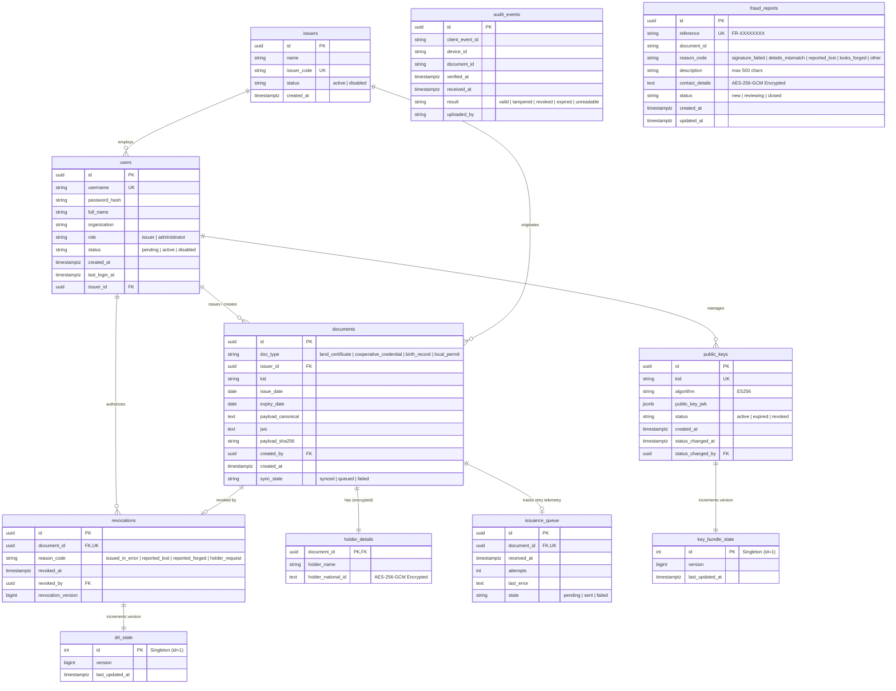

# WaseNet Backend: Digital Document Authentication API

[](https://www.python.org/)
[](https://fastapi.tiangolo.com/)
[](https://www.postgresql.org/)
[](https://www.sqlalchemy.org/)
[](https://cryptography.io/)
[](#)

Backend API and PostgreSQL database for **WaseNet**: an offline-first document authentication platform for public offices in Ethiopia.

---

## 1. Technology Stack & Architectural Decision

### Stack Choice: Python 3.12 with FastAPI & SQLAlchemy 2.x
**Architectural Justification:**
Python with FastAPI was chosen over Node.js because the WaseNet domain relies heavily on strict cryptographic verification, deterministic data canonicalization, and national data protection controls. FastAPI's integration with Pydantic v2 enforces schema validation at compile time, rejecting unauthorized fields and enforcing string length limits across all incoming payloads. Furthermore, FastAPI auto-generates the complete OpenAPI 3.1 specification directly from application models without manual drift. Python's mature `cryptography` and `argon2-cffi` ecosystems provide audited implementations of NIST P-256 ECDSA (ES256), SHA-256 hashing, AES-256-GCM envelope encryption, and memory-hard Argon2id hashing, adhering strictly to Ethiopian public-sector security guidelines (SRS-TC-2026-V1.1).

---

## 2. System Architecture & Database Schema



### Table Design Decisions
- **`issuance_queue` as a Dedicated Table:** We implemented `issuance_queue` as a dedicated operational table rather than a dynamic SQL view over `documents`. This isolates high-churn retry counters (`attempts`), transient error logs (`last_error`), and scheduling timestamps (`received_at`) from the primary immutable `documents` audit records, avoiding table and index bloat during offline batch synchronizations.
- **`sessions` Table Omission:** Absolute 8-hour expiry JWTs signed via HS256 (FR-1.3) contain all required authorization claims (`sub`, `role`, `org`, `issuer_id`). The server remains stateless and resilient against network outages, eliminating the need for a database session lookup on read requests.

---

## 3. Resolving SRS Ambiguities

During analysis of `SRS-TC-2026-V1.1`, the following four ambiguities were identified and systematically resolved:

| Ambiguity | Resolution & Implementation Decision |
|---|---|
| **1. Where signing happens (server vs client)** | In this build, signing is executed **server-side** by the backend API using an active ES256 private key loaded from the keystore/environment (`FR-2.1` to `FR-2.4`). All signing logic is strictly encapsulated behind an abstract `DocumentSigner` interface. This allows future phases to transition seamlessly to client-side signing (Web Crypto in browser) or INSA Hardware Security Modules (HSM) without modifying database schemas or API contracts. |
| **2. Whether issuers can see audit events from devices** | Verifier devices upload verification logs anonymously without user session tokens (`FR-5.1`). To maintain privacy and prevent surveillance leaks across jurisdictions, **administrators** can query all audit logs nationwide, while **issuers** are strictly scoped to audit logs that reference documents created by their respective public office (`Document.issuer_id == current_user.issuer_id`). |
| **3. Whether revocation is per document or per key** | Document revocation is strictly **per-document** (`document_id` with reason code in `revocations`) and increments the global DRL version counter (`FR-4.4`). Key revocation is handled independently in the `public_keys` table (`FR-4.3`), which marks a `kid` as `revoked` and increments `key_bundle_state.version`, causing all credentials signed under that key to immediately fail offline client validation. |
| **4. How administrator accounts are approved** | New administrator registrations default to `status = 'pending'` (`FR-1.1`). An existing active administrator must review pending accounts via `GET /api/v1/users/pending` and explicitly approve them via `POST /api/v1/users/{id}/approve`. The bootstrap administrator account is seeded on initial deployment via environment variables (`BOOTSTRAP_ADMIN_USERNAME`, `BOOTSTRAP_ADMIN_PASSWORD`), avoiding chicken-and-egg registration lockouts. |

---

## 4. Cryptography, Key Handling & Envelope Encryption

### 4.1 Document Signing (ES256 JWS)
Credentials use **ECDSA NIST P-256 (secp256r1) with SHA-256** and **IEEE P1363 64-byte raw signatures** (`r || s`):
1. **Canonicalization:** Payloads are serialized using deterministic RFC 8785 JSON (keys recursively sorted in ASCII order, no extraneous spaces, UTF-8 encoded).
2. **Hashing:** SHA-256 computes a 32-byte digest of the canonical string.
3. **Compact JWS:** Header (`{"alg":"ES256","kid":"...","typ":"JWT"}`) and canonical payload are Base64URL-encoded and signed. The 64-byte raw signature is appended:
   ```text
   [Base64URL(Header)].[Base64URL(Payload)].[Base64URL(Signature)]
   ```

### 4.2 Application-Level Envelope Encryption (AES-256-GCM)
Under SRS Section 4.1 (Data Minimization), personal identity attributes (`holder_national_id`) and fraud report `contact_details` are never stored in plaintext:
- Encrypted using **AES-256-GCM** with a 256-bit key from `AES_GCM_SECRET_KEY`.
- Each encryption generates a fresh 96-bit (12-byte) random nonce (`os.urandom(12)`).
- Stored envelope format: `v1:<nonce_b64>:<tag_b64>:<ciphertext_b64>`
- **Key Rotation:** To rotate keys, specify a new key version prefix (e.g. `v2:`) and run a batch re-encryption script that reads `v1:` records, decrypts with the old key, and writes `v2:` records with the new key. The database never has access to the cryptographic key.

---

## 5. Security & TLS 1.3 Termination (NFR-S3)

All production client traffic is encrypted over **HTTPS with TLS 1.3**. The FastAPI application runs behind a reverse proxy (such as Nginx, Caddy, or an AWS Application Load Balancer).

### Production Nginx TLS 1.3 Configuration
Place this configuration in `/etc/nginx/conf.d/wasenet.conf`:

```nginx
server {
    listen 80;
    server_name api.wasenet.gov.et;
    return 301 https://$host$request_uri;
}

server {
    listen 443 ssl http2;
    server_name api.wasenet.gov.et;

    # TLS 1.3 Enforced (NFR-S3)
    ssl_protocols TLSv1.3;
    ssl_prefer_server_ciphers on;
    ssl_ciphers TLS_AES_256_GCM_SHA384:TLS_CHACHA20_POLY1305_SHA256:TLS_AES_128_GCM_SHA256;

    ssl_certificate /etc/letsencrypt/live/api.wasenet.gov.et/fullchain.pem;
    ssl_certificate_key /etc/letsencrypt/live/api.wasenet.gov.et/privkey.pem;

    # Security Headers
    add_header Strict-Transport-Security "max-age=63072000; includeSubDomains; preload" always;
    add_header X-Content-Type-Options "nosniff" always;
    add_header X-Frame-Options "DENY" always;

    location / {
        proxy_pass http://127.0.0.1:8000;
        proxy_set_header Host $host;
        proxy_set_header X-Real-IP $remote_addr;
        proxy_set_header X-Forwarded-For $proxy_add_x_forwarded_for;
        proxy_set_header X-Forwarded-Proto https;
    }
}
```

---

## 6. Scheduled Data Retention Job (SRS Section 4.1)

In compliance with data protection policies, audit logs and closed fraud reports are automatically purged after the configured retention period (default: 365 days).

- Configurable via `RETENTION_DAYS_AUDIT` and `RETENTION_DAYS_FRAUD` in `.env`.
- To run manually:
  ```bash
  python scripts/run_retention.py
  # or
  make retention
  ```
- To schedule in Linux cron (daily at 02:00 AM UTC):
  ```cron
  0 2 * * * cd /path/to/backend && /path/to/venv/bin/python scripts/run_retention.py >> /var/log/wasenet-retention.log 2>&1
  ```

---

## 7. API Endpoints Reference & Access Matrix

Base Path: `/api/v1`

| Method | Endpoint | Access Role | Description |
|---|---|---|---|
| `POST` | `/auth/register` | Public | Register new issuer or admin account (starts pending) |
| `POST` | `/auth/login` | Public | Sign in with Argon2id; returns 8-hr JWT token |
| `POST` | `/auth/logout` | Authenticated | Acknowledges session sign-out |
| `GET` | `/auth/me` | Authenticated | Current user details and assigned roles |
| `GET` | `/keys/bundle` | Public (Verifier) | Active and expired ES256 public keys (FR-4.1) |
| `GET` | `/revocations?since=N` | Public (Verifier) | DRL delta updates added after version N (FR-4.2) |
| `POST` | `/audit/batch` | Public (Verifier) | Idempotent verification events batch upload (FR-5.1) |
| `POST` | `/documents` | Issuer / Admin | Validates, canonicalizes, signs, and stores credential |
| `GET` | `/documents?mine=true` | Issuer / Admin | Paginated credentials with type/date filters |
| `GET` | `/documents/{id}` | Issuer / Admin | Fetch full credential details and QR payload |
| `POST` | `/queue/sync` | Issuer / Admin | Idempotent offline issuance queue sync (FR-2.5) |
| `GET` | `/queue` | Issuer / Admin | Documents pending sync or failed for this issuer |
| `GET` | `/audit` | Issuer / Admin | Paginated audit queries (scoped to issuer docs) |
| `GET` | `/keys` | Administrator | List all registered public keys and statuses |
| `POST` | `/keys` | Administrator | Register public certificate (FR-4.3) |
| `PATCH` | `/keys/{kid}` | Administrator | Update key status (Active, Expired, Revoked) |
| `POST` | `/revocations` | Administrator | Revoke document with monotonic version lock (FR-4.4) |
| `GET` | `/issuers` | Administrator | List authorized public office issuers |
| `POST` | `/issuers` | Administrator | Create a new public office issuer record |
| `PATCH` | `/issuers/{id}` | Administrator | Enable or disable an issuer office |
| `GET` | `/users/pending` | Administrator | List user accounts awaiting approval |
| `POST` | `/users/{id}/approve` | Administrator | Activate a pending user account |
| `GET` | `/fraud-reports` | Administrator | Paginated fraud reports with status filter |
| `PATCH` | `/fraud-reports/{id}` | Administrator | Update report status (new, reviewing, closed) |
| `POST` | `/fraud-reports` | Public | Submit website fraud report; returns `FR-XXXXXXXX` |
| `GET` | `/sync/status` | Public | Global DRL version, Key Bundle version, UTC time |
| `GET` | `/health/live` | Public | Liveness probe (200 OK) |
| `GET` | `/health/ready` | Public | Readiness probe (verifies database connectivity) |

---

## 8. Running Locally

### Prerequisites
- Python 3.12+
- PostgreSQL 15+ (or Docker Compose)

### 8.1 With Docker Compose (Recommended)
```bash
# 1. Copy environment variables
cp .env.example .env

# 2. Build and launch database, one-off migration, and API
docker compose up --build -d

# 3. View logs
docker compose logs -f api
```

### 8.2 Without Docker (Local Virtualenv)
```bash
# 1. Create and activate virtual environment
python -m venv venv
# On Windows:
.\venv\Scripts\activate
# On Linux/macOS:
source venv/bin/activate

# 2. Install dependencies
pip install -r requirements.txt

# 3. Apply database migrations
alembic upgrade head

# 4. Seed database with initial admin, issuer, key, and demo revoked doc
python scripts/seed.py

# 5. Launch FastAPI development server
uvicorn app.main:app --host 0.0.0.0 --port 8000 --reload
```

---

## 9. Running the Tests

The test suite includes unit tests for all cryptographic algorithms, password policies, and migration lifecycle, as well as end-to-end integration tests verifying every API route and database constraint.

```bash
# Run all tests with pytest
pytest tests -v
```

---

## 10. Items Remaining Before Production Deployment

1. **Hardware Security Module (HSM):** Transition the server-side `ES256Signer` to an INSA-approved PKCS#11 HSM (or AWS CloudHSM / YubiHSM) so the private signing key cannot be extracted in software.
2. **INSA Gateway Live Integration:** Upgrade `app/services/insa_connector.py` from the prototype stub to the live mTLS INSA cyber incident gateway.
3. **Automated Database Backups:** Implement continuous archiving with WAL-G or pgBackRest to an encrypted, off-site object store with 30-day point-in-time recovery (PITR).
4. **Key Rotation Pipeline:** Establish a semi-annual cryptographic key rollover workflow that deprecates active signing keys and issues delta updates to field verifiers.
